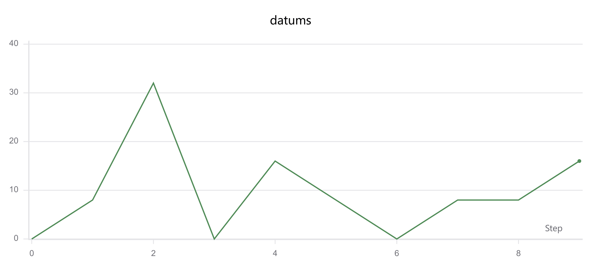
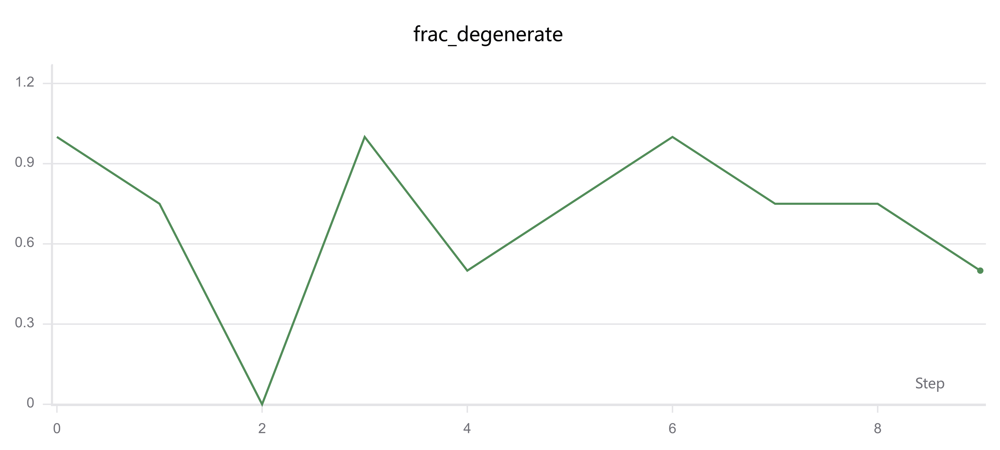
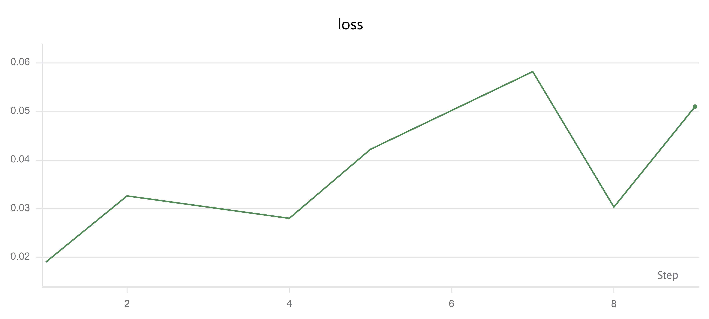
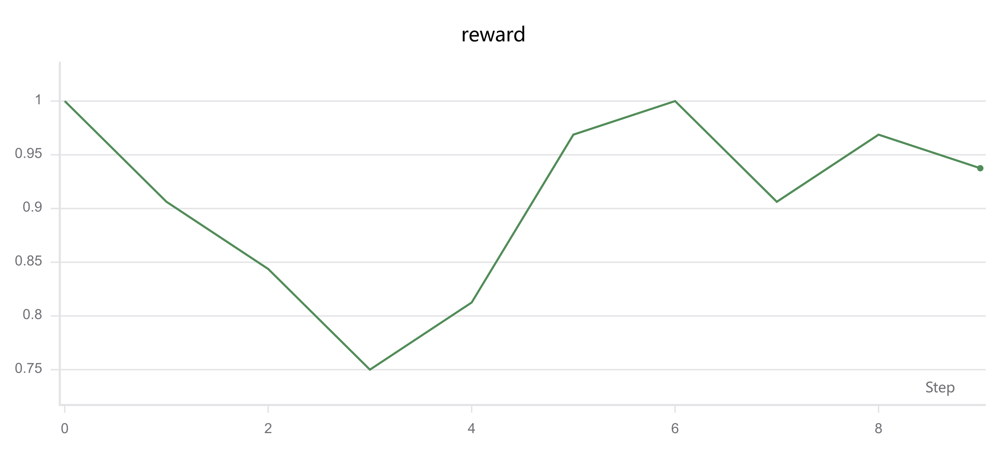
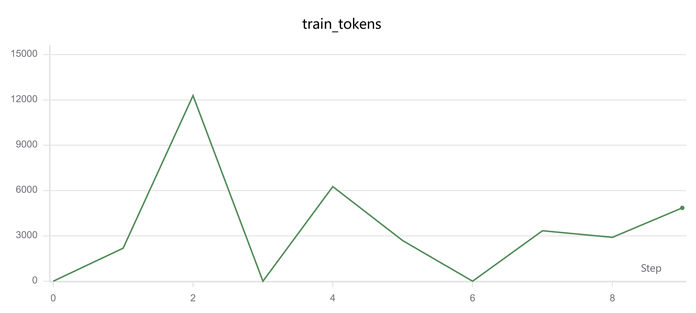

### Task00-GettingStarted

> 本文为 [DataWhale](https://github.com/datawhalechina) 开源项目 [agentic-rl-lab](https://github.com/datawhalechina/agentic-rl-lab) 的学习笔记与实验记录，感谢 DataWhale 与 PyTRIO 的支持。

**DataWhale** Agentic RL项目，主要内容是复现一系列RL算法（主要是GRPO与在线策略蒸馏）。

特点是采用Pytrio进行远程训练，从而避免对配置的需求，也能专注算法本身，用Swanlab进行训练监控。

**感谢DataWhale与Pytrio的支持。**

以下是预实验：
```python
uv run python experiments/grpo/01-demo-sync.py --steps 10 --batch-size 4 --group-size 8 --max-tokens 512 --swanlab-mode online
```



datums：当前训练步用于更新模型的样本数。



frac_degenerate：退化组占比，即同一道题的所有回答奖励相同、优势值全为零的组所占比例。



loss：训练损失。



reward：当前训练步生成回答的平均奖励。



train_tokens：当前训练步中优势值非零、实际参与训练的回答 token 数。

### Task01-Loss Function

**Loss的简单思想：做得好的token，我们就增大他的概率，做得差的就减少他的概率**


下面沿用 IS、PPO、CISPO 的解释方式，结合 [seagull-llm 的强化学习笔记](https://github.com/Seagull-W/seagull-llm/blob/main/docs/rl-book/cha6强化学习.html) 补充常见 loss。

统一记号：

`target_logprobs` 是当前模型对已采样 token 的 log probability，`sampling_logprobs` 来自采样时的旧模型，`advantages` 在更新时视为固定值。代码只展示 loss 核心，默认已排除 prompt 和 padding；二维张量为 `[回答数, token 数]`，变长回答用 `mask` 标记有效 token。

### 1. Importance Sampling

Importance Sampling 最直接。它问的是：当前模型和采样模型对同一个 token 的概率比例是多少？

```math
\mathcal{L}_{\mathrm{IS}}(\theta)
= -\mathbb{E}_{x\sim q}\left[\frac{p_\theta(x)}{q(x)}A(x)\right]
```

实现时把概率比例写成 logprob 之差的指数，因为优化器最小化 loss，所以加负号：

```python
prob_ratio = torch.exp(target_logprobs - sampling_logprobs.detach())
loss = -(prob_ratio * advantages.detach()).mean()
```

正 advantage 鼓励提高这个 token 的概率，负 advantage 鼓励降低它的概率。这里的“好”和“差”是相对于基线而言的。

ratio 负责修正采样权重。上式在 `x` 表示完整采样对象时是标准重要性采样；LLM 中常用的逐 token ratio 则是在采样到的上下文上构造策略代理目标。

### 2. PPO

PPO 关心的是：某个 token 已经朝期望方向改变很多了，还要继续推吗？

```math
r_t=\frac{\pi_\theta(a_t\mid s_t)}{\pi_{\mathrm{old}}(a_t\mid s_t)},\qquad
\mathcal{L}_{\mathrm{PPO}}
=-\mathbb{E}_t\left[\min\left(r_tA_t,
\operatorname{clip}(r_t,1-\epsilon_{\mathrm{low}},1+\epsilon_{\mathrm{high}})A_t\right)\right]
```

```python
ratio = torch.exp(target_logprobs - sampling_logprobs.detach())
adv = advantages.detach()
unclipped = ratio * adv
clipped = ratio.clamp(1 - eps_low, 1 + eps_high) * adv
loss = -torch.minimum(unclipped, clipped).mean()
```

例如 advantage 为正、ratio 已经达到 `1.8`，而上界为 `1.2`，这一项就进入平台区，不再继续奖励概率上升。advantage 为负时，对应的是 ratio 低于下界后的平台区。

因此 clip 限制的是样本继续推动更新的激励；模型参数由很多样本共同更新，ratio 仍可能超出区间。这里展示的是 PPO 的策略 loss。

### 3. CISPO

CISPO 先裁剪 ratio，再把它当成固定权重，乘到 `logprob * advantage` 上。

```math
\mathcal{L}_{\mathrm{CISPO}}
=-\mathbb{E}_t\left[
\operatorname{sg}\!\left(\operatorname{clip}(r_t,1-\epsilon_{\mathrm{low}},1+\epsilon_{\mathrm{high}})\right)
\log\pi_\theta(a_t\mid s_t)A_t\right]
```

```python
ratio = torch.exp(target_logprobs - sampling_logprobs.detach())
weight = ratio.clamp(1 - eps_low, 1 + eps_high).detach()
loss = -(weight * target_logprobs * advantages.detach()).mean()
```

`detach()` 表示裁剪后的 ratio 只控制学习力度，梯度通过 `target_logprobs` 回传。只要权重和 advantage 非零，ratio 越界也不会因为 PPO 式的平台区直接失去这一项梯度。

### 4. Cross-Entropy / SFT

SFT 问的是：给定前面的上下文，模型能不能把示范答案里的下一个 token 预测出来？

```math
\mathcal{L}_{\mathrm{SFT}}
=-\frac{1}{\sum_{i,t}m_{i,t}}
\sum_{i,t}m_{i,t}\log\pi_\theta(y_{i,t}^{*}\mid x_i,y_{i,<t}^{*})
```

```python
# target_logprobs：示范答案中正确 token 的 logprob
loss = -(target_logprobs * mask).sum() / mask.sum()
```

示范 token 的概率越低，负对数就越大；最小化 loss 会鼓励模型提高它的概率。`mask` 决定哪些回答位置参与学习，对应你在[监督微调笔记](https://github.com/Seagull-W/seagull-llm/blob/main/docs/rl-book/cha4对话模板与监督微调.html)里写的回答掩码。

这里的监督信号是示范答案，不需要额外计算 advantage。

### 5. REINFORCE / RLOO

REINFORCE 问的是：这次采样比预期好多少？然后用这个差值给 `logprob` 加权。

```math
\mathcal{L}_{\mathrm{REINFORCE}}
=-\frac{1}{B}\sum_{i=1}^{B}\sum_{t=1}^{T_i}
\log\pi_\theta(a_{i,t}\mid s_{i,t})\operatorname{sg}(A_{i,t})
```

```python
loss = -(
    target_logprobs * advantages.detach() * mask
).sum(dim=-1).mean()
```

正 advantage 推高概率，负 advantage 压低概率。这里先对回答内的 token 求和，再对回答求平均，保留整条回答的 logprob。

RLOO 沿用这个 loss，把同题其他回答的平均奖励作为基线。对同一题的 `G > 1` 个独立采样回答：

```math
A_i^{\mathrm{RLOO}}=R_i-\frac{1}{G-1}\sum_{j\ne i}R_j
```

```python
baseline = (rewards.sum() - rewards) / (rewards.numel() - 1)
advantages = (rewards - baseline).detach()[:, None]
```

上面的 REINFORCE 代码对应当前策略采样后的 on-policy 梯度估计；反复复用旧样本时，需要考虑采样分布变化。

### 6. GRPO

GRPO 问的是：同一道题的几个回答里，这个回答比组内平均水平好多少？它把这个比较结果放进 PPO 风格的 loss。

```math
\hat A_i=\frac{R_i-\bar R}{\operatorname{std}(R)+\delta},\qquad
\mathcal{L}_{\mathrm{GRPO}}
=-\frac{1}{G}\sum_{i=1}^{G}\frac{1}{T_i}\sum_{t=1}^{T_i}
\min\!\left(r_{i,t}\hat A_i,
\operatorname{clip}(r_{i,t},1-\epsilon,1+\epsilon)\hat A_i\right)
```

```python
# 此处一个 batch 展示同一道题的一组回答
adv = ((rewards - rewards.mean()) / (rewards.std(correction=0) + 1e-8)).detach()
ratio = torch.exp(target_logprobs - sampling_logprobs.detach())
objective = torch.minimum(
    ratio * adv[:, None],
    ratio.clamp(1 - eps, 1 + eps) * adv[:, None],
)
loss = -((objective * mask).sum(-1) / mask.sum(-1)).mean()
```

同一个回答的 token 共享结果奖励构造的 advantage。先对每条回答取 token 平均，再对回答取平均，因此每条回答拥有相同的总归一化权重。

这里展示策略项；原始 GRPO 还加上相对参考模型的 KL 惩罚：`loss = policy_loss + beta * kl_loss`。组内比较负责提供 advantage，clip 负责限制继续更新的激励。参见 [DeepSeekMath](https://arxiv.org/abs/2402.03300)。

### 7. Dr. GRPO

Dr. GRPO 进一步问：奖励的标准差、回答的长度，会不会额外改变样本的学习权重？

它使用未除以组内标准差的 advantage，并用固定长度常数归一化策略 loss：

```math
\hat A_i=R_i-\bar R,\qquad
\mathcal{L}_{\mathrm{Dr.GRPO}}
=-\frac{1}{G L_{\max}}\sum_{i=1}^{G}\sum_{t=1}^{T_i}
\min\!\left(r_{i,t}\hat A_i,
\operatorname{clip}(r_{i,t},1-\epsilon,1+\epsilon)\hat A_i\right)
```

```python
adv = (rewards - rewards.mean()).detach()[:, None]
ratio = torch.exp(target_logprobs - sampling_logprobs.detach())
objective = torch.minimum(ratio * adv, ratio.clamp(1 - eps, 1 + eps) * adv)
loss = -(objective * mask).sum() / (rewards.numel() * max_length)
```

每个有效 token 都除以同一个固定分母。短回答中的 token 不会因为回答短，就得到更大的归一化权重。

这对应你笔记里的“定长归一化”：需要同时看 advantage 的尺度和 loss 的分母。参见 [Dr. GRPO 论文](https://arxiv.org/abs/2503.20783)。

### 8. DAPO 的策略 Loss

DAPO 的 loss 保留 PPO 的 `min`，让上、下裁剪幅度可以不同，并把整个 batch 的有效 token 放在一起求平均。

```math
\mathcal{L}_{\mathrm{DAPO}}
=-\frac{1}{\sum_i T_i}\sum_i\sum_{t=1}^{T_i}
\min\!\left(r_{i,t}\hat A_i,
\operatorname{clip}(r_{i,t},1-\epsilon_{\mathrm{low}},1+\epsilon_{\mathrm{high}})\hat A_i\right)
```

```python
ratio = torch.exp(target_logprobs - sampling_logprobs.detach())
adv = advantages.detach()  # 已按同题组计算，并广播到 token
objective = torch.minimum(
    ratio * adv,
    ratio.clamp(1 - eps_low, 1 + eps_high) * adv,
)
loss = -(objective * mask).sum() / mask.sum()
```

较大的 `eps_high` 给提高概率留出更多空间。全 batch 的 token 平均让每个有效 token 拥有相同权重，长回答因为 token 更多，总权重也更大。

这里仅比较 DAPO 的策略损失，完整算法还有采样和奖励设计。可对照项目的 [DAPO 案例](../experiments/dapo/README.md)。

### 9. GSPO

GSPO 问的是：整条回答的概率总体改变了多少？它把一条回答的 token ratio 汇总为一个长度归一化的序列 ratio，再做一次裁剪。

```math
s_i=\exp\!\left(\frac{1}{T_i}\sum_{t=1}^{T_i}\log r_{i,t}\right),\qquad
\mathcal{L}_{\mathrm{GSPO}}
=-\frac{1}{G}\sum_i\min\!\left(s_i\hat A_i,
\operatorname{clip}(s_i,1-\epsilon_{\mathrm{low}},1+\epsilon_{\mathrm{high}})\hat A_i\right)
```

```python
log_ratio = target_logprobs - sampling_logprobs.detach()
seq_ratio = torch.exp((log_ratio * mask).sum(-1) / mask.sum(-1))
adv = sequence_advantages.detach()
loss = -torch.minimum(
    seq_ratio * adv,
    seq_ratio.clamp(1 - eps_low, 1 + eps_high) * adv,
).mean()
```

同一回答共享一个裁剪结果。`seq_ratio` 是 token ratio 的几何平均，完整序列概率比则是它们的乘积；长度归一化后的量是 GSPO 使用的代理权重。

这对应你强化学习笔记中的“序列级 ratio”，也可对照项目的 [GSPO 案例](../experiments/gspo/README.md)。

### 10. Bradley–Terry 奖励模型 Loss

奖励模型问的是：同一个问题的两个回答，能不能给 chosen 更高的分数？

```math
\mathcal{L}_{\mathrm{RM}}
=-\mathbb{E}_{(x,y_w,y_l)}\left[
\log\sigma\!\left(r_\phi(x,y_w)-r_\phi(x,y_l)\right)\right]
```

```python
loss = -torch.nn.functional.logsigmoid(
    chosen_scores - rejected_scores
).mean()
```

chosen 分数比 rejected 高得越多，偏好概率越接近 1，loss 越小。这里训练的是奖励模型的评分能力。

loss 只看分数差：两个分数一起加上同一个常数，loss 不变。这就是你在[奖励建模笔记](https://github.com/Seagull-W/seagull-llm/blob/main/docs/rl-book/cha5奖励建模.html)里讨论的成对偏好目标。

### 11. DPO

DPO 同样使用 chosen / rejected，但直接问：相对于参考模型，当前模型有没有更偏向 chosen？

```math
\mathcal{L}_{\mathrm{DPO}}
=-\mathbb{E}\left[\log\sigma\!\left(
\beta\left[
\log\frac{\pi_\theta(y_w\mid x)}{\pi_{\mathrm{ref}}(y_w\mid x)}
-\log\frac{\pi_\theta(y_l\mid x)}{\pi_{\mathrm{ref}}(y_l\mid x)}
\right]\right)\right]
```

```python
# 每个 logp 都是回答有效 token 的 logprob 之和
chosen_gain = chosen_logp - ref_chosen_logp.detach()
rejected_gain = rejected_logp - ref_rejected_logp.detach()
loss = -torch.nn.functional.logsigmoid(
    beta * (chosen_gain - rejected_gain)
).mean()
```

Bradley–Terry 用奖励模型输出的分数差；DPO 用当前策略相对参考策略的 logprob 增量之差。两者都用 `-logsigmoid`，被更新的模型和输入量不同。

DPO 优化的是相对偏好的差距；chosen 的绝对概率未必在每一步都上升。标准公式使用整条回答的 logprob 求和，改成 token 平均就改变了目标。参见 [DPO 原论文](https://arxiv.org/abs/2305.18290)。

### 12. Value / Critic Loss

Critic 问的是：我之前预测“从这里继续能拿多少回报”，预测准了吗？

```math
\mathcal{L}_{V}(\phi)
=\frac{1}{2}\mathbb{E}_t\left[
\left(V_\phi(s_t)-\operatorname{sg}(\hat R_t)\right)^2\right]
```

```python
loss = 0.5 * (
    (values - returns.detach()).square() * mask
).sum() / mask.sum()
```

`returns` 是固定的回报目标，可以由实际累计回报构造，也可以使用 `old_values + GAE_advantages`。预测偏高就往下调，预测偏低就往上调。

它训练的是价值预测。PPO 的策略 loss 利用 advantage 更新动作概率，Critic loss 则让价值估计更准确；两者承担不同任务。

### 13. 一句话比较

| Loss | 人话比喻 | 核心动作 | 最容易误解的点 |
| --- | --- | --- | --- |
| Importance Sampling | 按功劳发奖金，再校正样本权重 | `ratio * advantage` | 优化器最小化的是负目标，loss 可以为负 |
| PPO | 已经奖励够了就停一下 | `min(unclipped, clipped)` | clip 限制继续激励，不是 ratio 的硬边界 |
| CISPO | 给学习力度挂固定砝码 | `detach(clipped_ratio) * logprob * advantage` | ratio 不走梯度，梯度通过 logprob 回传 |
| SFT / Cross-Entropy | 照着示范答案学 | `-logprob_of_target` | 监督信号是示范 token，要明确参与学习的位置 |
| REINFORCE / RLOO | 按超出预期的表现奖惩 | `-logprob * advantage` | RLOO 改的是基线，使用同题其他回答的均值 |
| GRPO | 同题回答互相比成绩 | 组内标准化 advantage + token clip | 组内 advantage 与 PPO 式裁剪是两个组成部分 |
| Dr. GRPO | 少让分数尺度和答题长度影响权重 | 去标准差缩放 + 固定分母 | 只去掉标准差，还没有包含定长归一化的变化 |
| DAPO 策略 Loss | 放宽上限，按 token 算账 | 非对称 clip + 全 batch token mean | 长回答含更多 token，总归一化权重也更大 |
| GSPO | 整份答案一起调整 | 序列几何平均 ratio + sequence clip | 几何平均 ratio 不等于完整序列概率比 |
| Bradley–Terry RM | 训练一个会比较的评分员 | `-logsigmoid(chosen_score - rejected_score)` | 学的是奖励分数差，绝对分数没有唯一零点 |
| DPO | 直接学会更偏向好答案 | 对参考模型校正后的偏好差做 `-logsigmoid` | 使用回答 logprob 之和，优化相对偏好差距 |
| Value / Critic | 校准“能拿多少分”的预测 | `(value - return_target)²` | 它优化价值预测，目标回报要停止梯度 |
