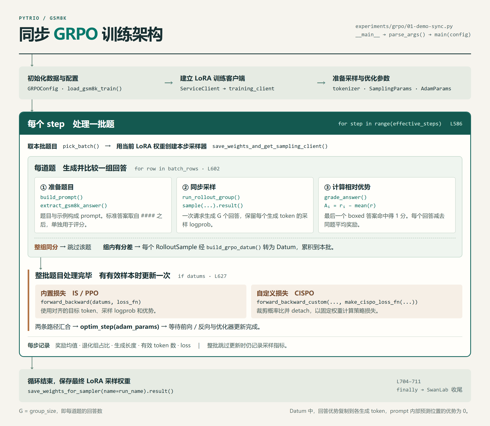

### task03 grpo demo

#### 零、前言
关于GRPO的内容，可以参考我的个人网页，包括[强化学习笔记](http://127.0.0.1:5173/rl-book/cha6%E5%BC%BA%E5%8C%96%E5%AD%A6%E4%B9%A0#grpo-group-relative-policy-optimization)、[deepseek-r1论文解读](http://127.0.0.1:5173/papers/deepseek-r1/)

**GRPO(组相对策略优化算法)** 的核心是：对于同一个 prompt 一次采样多个回答，让这些回答在组内相互比较，用“相对于组内其他回答好多少”来构造优势，而不再像 PPO 那样额外训练一个 Critic / Value Model 来估计价值函数。

相较于PPO，最大的优势是极大地降低了训练过程的显存占用，提高了训练的效率。

RLVR，可验证奖励的特点是根据规则来确定奖励分数，常用于数学/代码等验证性强的场景。

GSM8k是由8500道数学问题组成（放在当前标准算比较简单的题目）的benchmark数据集。

#### 一、代码解读

给出如下架构图


#### 二、运行结果

##### 2.1 With importance sampling loss 

运行代码：
```bash
uv run python experiments/grpo/01-demo-sync.py \
    --steps 10 \
    --batch-size 4 \
    --group-size 8 \
    --max-tokens 512 \
    --loss-fn importance_sampling \
    --swanlab-mode online
```

Swanlab监测结果：

