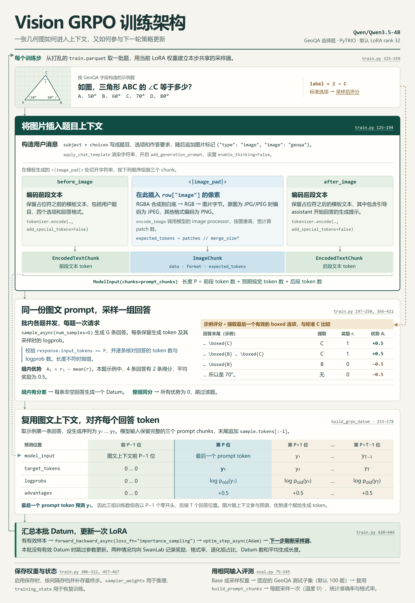
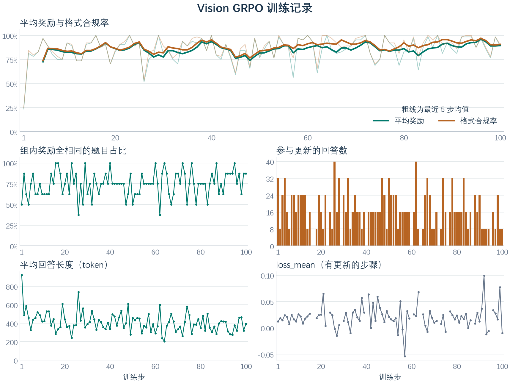
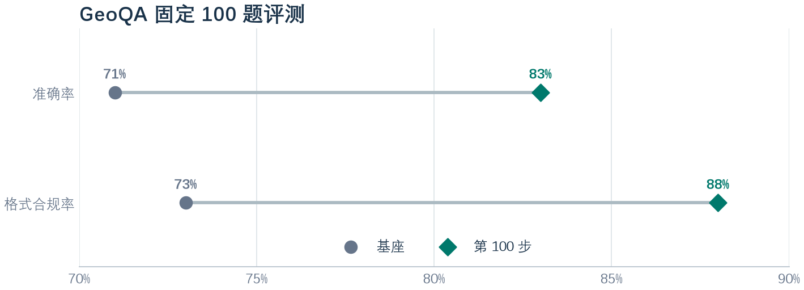

### task03 vision grpo

#### 一、代码解读

##### 1.1 把几何图插进图文 prompt

GeoQA 每题包含几何图、题干和四个选项。代码用 `ImageChunk` 替换对话模板中的图片占位符，按「题干和选项、图片、回答起点」拼接。图片占用的视觉 token 数为 `patches // merge_size**2`，采样时用服务端返回的 `input_tokens` 核对整个 prompt 的长度。[图文输入](../experiments/vision-grpo/train.py#L146)

##### 1.2 在同一份图文上下文中采样和评分

同一题采样 8 条回答。评分器取最后一个合法的 `\boxed{A}` 至 `\boxed{D}`，答对得 1 分，其余得 0 分。每条回答的优势是自己的奖励减去组内均值。全对或全错时，整组优势为零，跳过这道题。[采样与评分](../experiments/vision-grpo/train.py#L218)

##### 1.3 保留图文上下文，对齐回答 token

设图文 prompt 长度为 `P`。模型输入保留完整 prompt，再拼上 `completion[:-1]`，因此位置 `P - 1` 预测第一个回答 token。训练目标、采样时的 logprob 和优势都从这里开始填，前面补零，只有回答部分参与策略损失。[构造 Datum](../experiments/vision-grpo/train.py#L274)

##### 1.4 按图文序列长度分批反传

有效回答按图文总长度降序排列，再按样本数、图片数和 padding 后的 token 数切成 micro-batch。本次每批最多 4 张图，各批按样本占比累积梯度，最后更新一次参数。[分批与更新](../experiments/vision-grpo/train.py#L302)

#### 二、训练结果

Qwen3.5-4B 使用 LoRA（rank 32，学习率 `4e-5`）训练 100 步，每步 8 题、每题 8 条回答，耗时约 1 小时 54 分钟。从前 10 步到最后 10 步，平均奖励从 0.773 升到 0.911，格式合规率从 78.6% 升到 92.5%，同题 8 条回答奖励完全相同的比例也从 67.5% 升到 85.0%。[SwanLab 运行记录](https://swanlab.cn/@WenJiaxin/agentic-rl-lab-vision-grpo/runs/5fgjgxfb) · [本地绘图脚本](figures/task03/plot_results.py)

800 个题组中，201 组有奖励差异，共 1,608 条回答参与训练。11 步的 8 个题组全部同奖，因此实际更新参数 89 次，这 11 步没有 loss 记录。第 100 步保存了[评测权重](trio://run_bhjht9x46cyy/sampler_weights/vision-grpo-qwen35-4b-geoqa-step-100-sampler)和[续训状态](trio://run_bhjht9x46cyy/weights/vision-grpo-qwen35-4b-geoqa-step-100-state)。

#### 三、GeoQA 测评

基座和第 100 步的 sampler 在同一组 100 道测试题上各答一次，温度为 0，最多生成 1,024 个 token。准确率从 **71% 升到 83%**，格式合规率从 **73% 升到 88%**。两次评测分别耗时 64.28 秒和 193.70 秒。逐题结果保存在评测脚本同目录的 `eval-results-base.json` 和 `eval-results-step-100.json`。[评测脚本](../experiments/vision-grpo/eval.py)

逐题对照后，基座能提取选项的 73 题在训练后都选了原答案，其中 71 题正确。基座提取不到选项的 27 题，训练后有 12 题答对、3 题给出错误选项、12 题仍提取不到选项。例如第 3333 题，基座已经算出正确的 50°，却没给出可提取的选项。训练后它算出同样的角度，并以 `\boxed{B}` 作答。
