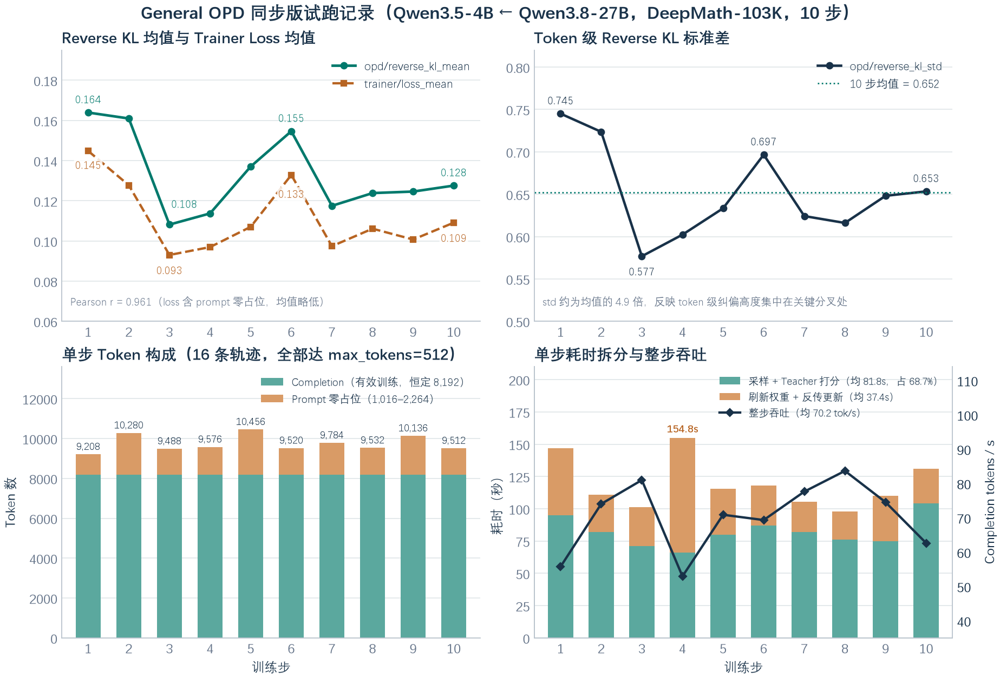

### task04 general opd

> 本文为 [DataWhale](https://github.com/datawhalechina) 开源项目 [agentic-rl-lab](https://github.com/datawhalechina/agentic-rl-lab) 的学习笔记与实验记录，感谢 DataWhale 与 PyTRIO 的支持。

#### 一、OPD 原理

##### 1.1 核心思想与训练闭环

**OPD（On-Policy Distillation，在线策略蒸馏）** 把「学生自己生成轨迹（on-policy）」和「老师逐 token 纠偏（dense feedback）」结合在一起。传统离线蒸馏往往让学生背老师提前写好的答案，但真正推理时学生是沿着自己的分布一步步往后生成的，一旦走出训练集没覆盖过的错误路径，就容易雪崩（exposure bias）。

OPD 换了思路：不让老师重新答题，而是让**当前 student** 先对 prompt 采样出自己的回答，再把 `prompt + student completion` 这条完全相同的 token 序列交给冻结的 **teacher** 做一次前向打分（`compute_logprobs`），得到每个 completion token 的对数概率，最后用两者差值驱动 student 向 teacher 靠拢。[同步版实现](../experiments/general-opd/01-demo-sync.py)

整个训练步是一个五步闭环：

1. **刷新 sampler**：每步开始把当前 student LoRA 权重导出为采样客户端（`sampler_refresh_steps=1`，严格 on-policy）。[刷新采样器](../experiments/general-opd/01-demo-sync.py#L306)
2. **学生自采样**：对 batch 内每道题采样 `group_size` 条回答，记录生成的 `tokens` 和采样时的旧策略 `student_lps`。[学生采样](../experiments/general-opd/01-demo-sync.py#L327)
3. **老师逐 token 打分**：把 `prompt_ids + completion_ids` 拼起来交给 teacher，截取 completion 区间对应的 `teacher_lps`。[Teacher 打分](../experiments/general-opd/01-demo-sync.py#L182)
4. **构造逐 token 优势并右移对齐**：计算 `reverse_kl = student_lps - teacher_lps` 与 `advantages = -beta * reverse_kl`，prompt 区间用 0 占位不参与损失。[构造 Datum](../experiments/general-opd/01-demo-sync.py#L203)
5. **策略更新**：用 `importance_sampling` 做一次前向/反向和 `Adam` 参数更新。[更新参数](../experiments/general-opd/01-demo-sync.py#L356)

##### 1.2 Reverse KL 与 Importance Sampling 更新

设 prompt 为 $x$，当前 student 策略为 $\pi_\theta$，冻结 teacher 为 $\pi_T$。OPD 最小化从 student 到 teacher 的**反向 KL 散度（Reverse KL）**：

```math
D_{\mathrm{KL}}\left(\pi_\theta \parallel \pi_T\right)
= \mathbb{E}_{y \sim \pi_\theta(\cdot \mid x)}\left[\log \pi_\theta(y \mid x) - \log \pi_T(y \mid x)\right]
```

展开到第 $t$ 个生成 token，对应的单样本估计与逐 token advantage 分别为：

```math
r_t^{\mathrm{KL}} = \log \pi_{\mathrm{old}}(y_t \mid x, y_{<t}) - \log \pi_T(y_t \mid x, y_{<t}), \qquad
A_t = -\beta\, r_t^{\mathrm{KL}}
```

直觉上非常直接：

- 当 $\log \pi_{\mathrm{old}} > \log \pi_T$（学生比老师更偏爱该 token）时，$r_t^{\mathrm{KL}} > 0 \Rightarrow A_t < 0$，更新会压低这个 token 的概率；
- 当 $\log \pi_{\mathrm{old}} < \log \pi_T$（老师比学生更认可该 token）时，$r_t^{\mathrm{KL}} < 0 \Rightarrow A_t > 0$，更新会提高这个 token 的概率；
- 单个 token 的 $r_t^{\mathrm{KL}}$ 允许为负，只有对 $\pi_\theta$ 完整分布取期望时 KL 才保证非负。

训练侧复用 PyTRIO 的 `importance_sampling` 损失（对照 [task_01 的 Loss 总结](task_01.md)）：

```math
\mathcal{L}_{\mathrm{IS}}(\theta)
= -\mathbb{E}_{y \sim \pi_{\mathrm{old}}}\left[\frac{\pi_\theta(y_t \mid x, y_{<t})}{\pi_{\mathrm{old}}(y_t \mid x, y_{<t})}\,\operatorname{sg}(A_t)\right]
```

因为本实验每步都刷新 sampler 且只做一次更新，反传时 $\pi_\theta \approx \pi_{\mathrm{old}}$，重要性比值接近 $1$，此时：
- 梯度上等价于带逐 token 密集优势的策略梯度；
- 数值上 $-\frac{\pi_\theta}{\pi_{\mathrm{old}}} A_t \approx -1 \cdot (-\beta r_t^{\mathrm{KL}}) = \beta r_t^{\mathrm{KL}}$，所以日志里的 `trainer/loss_mean` 会与 `opd/reverse_kl_mean` 同号且高度同步。

---

#### 二、OPD 与相似方法的区别

##### 2.1 OPD vs SFT / 离线蒸馏（SeqKD / Off-policy KD）

- **轨迹分布与暴露偏差**：SFT 和离线蒸馏（如 SeqKD）使用的是静态数据或 teacher 预先生成的回答（off-policy），学生只见过“好答案”的前缀；OPD 由学生实时采样（on-policy），直接把监督打在学生当下最容易走偏的状态上。
- **散度方向与模式选择**：标准 SFT / 离线蒸馏本质上最小化 Forward KL $D_{\mathrm{KL}}(\pi_T \parallel \pi_\theta)$，倾向于 **mode-covering**——逼着小模型覆盖老师分布的全部模式，容量不足时容易“摊薄概率”导致胡言乱语或覆盖掉原有通用能力；OPD 最小化 Reverse KL $D_{\mathrm{KL}}(\pi_\theta \parallel \pi_T)$，倾向于 **mode-seeking**——把概率集中在老师最认可的高概率模式上，对小模型更友好，更新也更“柔和”，不易引发灾难性遗忘。
- **词表与模型访问约束**：SFT 只看文本，可以跨模型家族蒸馏；OPD 需要逐 token 比较 logprob，要求 student 与 teacher **共享兼容的 tokenizer**，且 teacher 必须支持 logprob 计算（纯文本黑盒 API 无法直接使用）。

##### 2.2 OPD vs RLVR / GRPO

- **监督粒度（密集 vs 稀疏）**：GRPO 等 RLVR 算法只根据最终答案对错给整条回答一个标量 reward（outcome-level），整条回答的所有 token 共享同一个 advantage；OPD 在每个 token 位置都有独立的 $A_t$，信用分配粒度细得多，也不需要编写验证规则或准备标准答案。
- **退化组问题**：在 [task_02](task_02.md) 和 [task_03](task_03.md) 中可以看到，GRPO 一旦遇到组内全对或全错，优势全为零，只能整组跳过（Vision GRPO 后期退化组比例高达 85%）。OPD 每条回答独立接受 teacher 逐 token 评分，**不存在退化组丢样本问题**；脚本里的 `group_size` 仅用于增加同题采样覆盖，不做组内减均值对比。
- **能力上限**：OPD 的上限受限于 teacher，很难靠纯蒸馏稳定超越老师；RLVR 则依赖环境或规则验证器，有机会探索出超越初始模型甚至教师模型的解法。两者通常是前后衔接或混合互补的关系。

##### 2.3 OPD vs OPSD（On-Policy Self-Distillation）

仓库后续的 [OPSD](../experiments/opsd/readme.md) 可以看作 OPD 的“无外部大模型”变体：通用 OPD 需要一个外部更强模型（如本实验的 27B）或领域专家 LoRA 当 teacher；OPSD 则用**同一个模型**（或其冻结副本）在额外看到参考答案/特权上下文（privileged context）时充当 teacher，给“闭卷答题”的 student 轨迹逐 token 打分。OPSD 省去了外部大模型与词表对齐的限制，但前提是训练集需要提供可构造特权提示的参考答案或辅助信息。

##### 2.4 一表对比

| 维度 | SFT / 离线蒸馏 | OPD（本文） | OPSD（自蒸馏） | GRPO / RLVR |
| --- | --- | --- | --- | --- |
| 轨迹来源 | 固定数据 / Teacher 预生成（off-policy） | 当前 Student 实时采样（on-policy） | 当前 Student 闭卷采样（on-policy） | 当前策略实时采样（on-policy） |
| 监督信号 | 示范 token 交叉熵（逐 token） | 外部 Teacher logprob 差（逐 token 密集） | 同模型特权上下文 logprob 差（逐 token 密集） | 可验证结果奖励（序列级稀疏） |
| 核心目标 | Forward KL（mode-covering） | Reverse KL（mode-seeking） | Reverse KL（mode-seeking） | 组内相对优势最大化 |
| 数据要求 | 需完整 `(prompt, response)` | 仅需 prompt（无需答案） | 需 prompt + 参考答案/特权信息 | 需 prompt + 可验证规则/答案 |
| Tokenizer 要求 | 可跨词表 | Student 与 Teacher 必须兼容 | 天然一致（同模型） | 无外部模型约束 |
| 退化组跳过 | 无 | 无（100% 样本参与更新） | 无 | 常见（全对/全错即跳过） |
| 能力上限 | 受限于静态数据质量 | 受限于外部 Teacher | 受限于自身开卷上限 | 可探索超越初始/教师模型 |

---

#### 三、适用场景与局限

**适合优先使用 OPD 的场景：**

1. **大模型向小模型压缩提速**：同家族大模型（如 27B/72B）向小模型（如 4B/7B）迁移推理风格、格式与分布，只需准备 prompt 池即可开训。
2. **缺乏确定性验证器的开放任务**：开放问答、长文写作、对话风格对齐、复杂指令遵循、多步 Agent 行为模仿等难以写死 reward 规则的任务，RLVR 难以落地，而 OPD 可以提供稳定的 token 级偏好监督。
3. **领域能力增强且防止通用能力遗忘**：相较 SFT 容易破坏原分布，配合领域专家 teacher 与原始 base teacher（如仓库 [Medical OPD](../experiments/medical-opd/readme.md) 中的分阶段锚点恢复或双教师交替），更容易在提分的同时守住通用能力。
4. **RLVR 冷启动 / 缓解全错退化**：当小模型在难题上几乎答不对、GRPO 退化组逼近 100% 时，可先用 OPD 把策略拉进有效解区域，再切入 GRPO 冲上限。

**需要注意的边界条件：**

- **强依赖同词表白盒 Teacher**：必须能拿到对齐 token ID 的逐 token logprob；无法直接用不同词表或闭源文本 API 模型做标准 OPD。
- **不解决“超越老师”的问题**：如果目标是在数学/代码等可验证领域突破 teacher 上限，仍需引入 RLVR 或环境反馈。
- **在线开销高于静态 SFT**：每步都包含 student 自回归采样和 teacher 前向打分（虽然 teacher 只需一次 prefill 而非解码，但仍明显慢于离线 SFT）。

---

#### 四、同步版 Demo 实验与结果分析

本次运行命令如下：

```bash
uv run python experiments/general-opd/01-demo-sync.py \
  --steps 10 \
  --batch-size 4 \
  --group-size 4 \
  --max-tokens 512 \
  --sample-size 100 \
  --swanlab-mode online
```

实验配置：Student 为 `Qwen/Qwen3.5-4B`（LoRA rank 32，学习率 `4e-5`，关闭 thinking），Teacher 为冻结的 `Qwen/Qwen3.8-27B`，数据取自 `AI-ModelScope/DeepMath-103K` 第 1 分片随机抽样的 100 道题（仅用 `question` 字段作为 prompt）。每步采样 4 题 × 每题 4 条 = 16 条轨迹，`kl_penalty_coef = 1.0`，`sampler_refresh_steps = 1`，共训练 10 步，总计耗时约 **20 分 04 秒**（1,204 秒），最终导出权重保存在 `trio://run_xq69x9p15yos/sampler_weights/opd-deepmath-qwen35-4b-sync`。[SwanLab 运行记录](https://swanlab.cn/@WenJiaxin/agentic-rl-lab-opd/runs/mgpcfyoz) · [本地绘图脚本](figures/task04/plot_results.py)



结合上图和逐 step 日志，可以得到四点观察：

1. **Reverse KL 温和回落，且与 Trainer Loss 高度自洽**
   - `opd/reverse_kl_mean` 从第 1 步的 **0.1639** 降至第 10 步的 **0.1276**（前 3 步均值 `0.1443` → 后 3 步均值 `0.1253`，前 5 步均值 `0.1368` → 后 5 步均值 `0.1296`）。中间第 3 步探低至 `0.1081`，第 6 步回升至 `0.1546`，第 7–10 步落在 `0.1175–0.1276` 区间。每步只有 4 道新题，不同题目上 4B 与 27B 的天然分歧会带来明显批次波动，因此 10 步表现为“高位起步、带波动收敛”。
   - `opd/reverse_kl_std` 10 步均值为 **0.6519**（范围 `0.5768–0.7450`，同样从第 1 步 `0.7450` 降至第 10 步 `0.6533`），约为均值的 **4.9 倍**。这符合自回归蒸馏的常见形态：大量常规连接词与固定表述上 student 与 teacher 几乎一致，真正产生大梯度的是少数关键推理分叉 token。
   - `trainer/loss_mean`（`0.0930–0.1448`）与 `opd/reverse_kl_mean` 的 Pearson 相关系数高达 **0.961**。进一步核对总和：`trainer/loss_sum` 与 `8,192 × reverse_kl_mean` 的比值在全部 10 步都落在 `0.990–1.000` 之间（微小差值来自采样端与训练端数值精度差），验证了严格 on-policy 下 IS 目标与反向 KL 的一致关系；`loss_mean` 之所以系统性地略低于 `reverse_kl_mean`，是因为 `trainer/token_count`（`9,208–10,456`）计入了 prompt 区间用 `0` 占位的 token（每步 `1,016–2,264` 个，折合单条 prompt 约 `63.5–141.5` token），拉低了整序列平均。

2. **样本 100% 有效，但 160 条轨迹全部撞到 512 长度上限**
   - 每步 `data/datums` 恒为 **16**，10 步共 40 道题、160 条回答全部参与了梯度更新，没有出现 GRPO 那样的退化组跳过。
   - 但每步 `data/completion_tokens_mean` 严格等于 **512.0**（每步固定 `8,192` 个 completion token，10 步共 `81,920` 个），说明所有生成都在达到 `max_tokens=512` 时被强行截断，未能自然生成 EOS。DeepMath 题目在 `step by step` 推导下普遍需要更长篇幅，因此在 512 预算内，本次训练主要是在**前半段解题思路**上向 27B 对齐，尚未覆盖收尾推理与最终 `\boxed{}` 答案。

3. **同步版近七成时间耗在串行采样与 Teacher 打分**
   - 10 个训练步累计耗时 **1,191.52 秒**（平均 **119.15 秒/步**，最快第 8 步 `97.94 秒`，最慢第 4 步 `154.76 秒`），整步吞吐 `completion_tokens_per_second` 均值 **70.2 tokens/s**（`52.9–83.6`）。
   - 结合 `tqdm` 进度条记录拆分阶段耗时：每步串行执行 4 次 student `sample` 和 16 次 teacher `compute_logprobs` 平均消耗 **81.8 秒/步**，占总步时的 **68.7%**（范围 `66–104 秒`）；刷新权重、`forward_backward` 与 `optim_step` 平均占 **37.4 秒/步**（第 4 步出现一次 `88.8 秒` 的远端等待毛刺，对应图中的耗时尖峰与吞吐低谷）。若要拉长步数，切换到并发提交请求的 [`02-demo-async.py`](../experiments/general-opd/02-demo-async.py) 是最直接的优化。

4. **结论边界与后续计划**
   - 这次 10 步试跑验证了 DeepMath 数据下载、严格 on-policy 采样、27B teacher 逐 token 打分、reverse KL 更新与权重保存的完整链路，且 KL 与 loss 走势健康、无 NaN 或异常尖峰。
   - 但需要明确边界：**reverse KL 下降只说明 student 在前 512 token 上更贴近 teacher，不能自动推导出数学解题准确率已提升**。本脚本只使用 prompt 未做答案评测，且 10 步规模很小、回答全部截断；后续若要观察真实任务增益，建议：（1）切到异步版提升吞吐；（2）将 `max_tokens` 放宽至 `1024–2048` 以覆盖完整推导与 `\boxed{}`；（3）扩大训练步数并在固定数学测试集上对比基座与保存权重。
