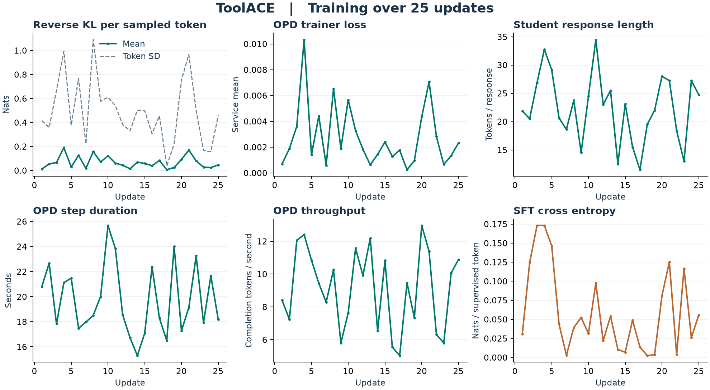
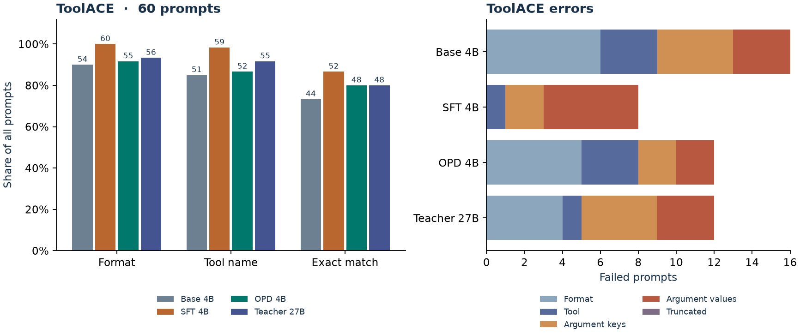

### task05 general opd 实战与 SFT 对照

> 本文为 [DataWhale](https://github.com/datawhalechina) 开源项目 [agentic-rl-lab](https://github.com/datawhalechina/agentic-rl-lab) 的学习笔记与实验记录，感谢 DataWhale 与 PyTRIO 的支持。

#### 一、场景选择与实验设计

在 [Task04](task_04.md) 的 DeepMath 试跑中，4B Student 生成的 160 条回答全部用满了 512 token 上限，训练只覆盖了推导前半段，几乎没机会给最终答案打分。本次实战改用单轮工具调用数据集 `Team-ACE/ToolACE`：模型读取用户请求与候选工具说明，直接输出一条带参数的函数调用（选对接口算工具名正确，参数键和值也一致才算整题正确）。回复本身很短，既能避开截断、压低 PyTRIO 开销，也方便本地解析打分，不实际执行工具。

从 11,300 条原始记录中，保留原始 system prompt、不额外加格式示例，只取第一组 user / assistant 对话，按「2–5 个候选工具、system ≤ 2,500 字符、标准调用 ≤ 400 字符且可解析」筛选出 752 条，对用户请求去重后剩 747 条；固定种子 42 切出 200 条训练池和 60 条评测集（零重叠）。[数据准备脚本](../experiments/general-opd/toolace/00-prepare-data.py)

为了公平对照 **General OPD** 与 **离线 SFT**，两组均从同一个 `Qwen/Qwen3.5-4B` 基座出发，使用相同 LoRA（rank 32）、学习率 `4e-5`、关闭 thinking，按相同顺序覆盖训练池前 100 条请求，各更新 25 步（每步 4 题）。核心差异只落在监督方式本身：

| 对比项 | General OPD（异步） | 离线 SFT |
| --- | --- | --- |
| 监督来源 | 只用 `system + user`（prompt-only），由冻结的 `Qwen/Qwen3.8-27B` 对 4B 采样轨迹逐 token 打分 | 数据集中的标准 `assistant` 调用与 EOS |
| 更新目标 | 每题采 2 条轨迹，`importance_sampling` 优化 reverse KL（`kl_penalty_coef = 1.0`） | 4 条标注样本，回答与 EOS 区间计算 `cross_entropy`（prompt 权重为 0） |
| 采样 / 长度 | 每步刷新 sampler，`temperature = 1.0`，`max_tokens = 256`，并发 8 | `max_length = 1,024`，无需在线采样 |
| 训练脚本与记录 | [01-train-opd-async.py](../experiments/general-opd/toolace/01-train-opd-async.py) · [SwanLab](https://swanlab.cn/@WenJiaxin/agentic-rl-lab-opd/runs/il9bm5xb) | [02-train-sft-async.py](../experiments/general-opd/toolace/02-train-sft-async.py) · [SwanLab](https://swanlab.cn/@WenJiaxin/agentic-rl-lab-opd/runs/5e052iht) |

训练结束后分别导出 sampler 权重用于评测：OPD 为 `trio://run_1p6ij55dcxu9/sampler_weights/toolace-opd-step25`，SFT 为 `trio://run_ibas1nlgbbu3/sampler_weights/toolace-sft-step25`。

---

#### 二、训练过程对比：OPD vs SFT

结合训练曲线与逐步汇总数据（[OPD summary](../experiments/general-opd/toolace/runs/opd_summary.json) · [SFT summary](../experiments/general-opd/toolace/runs/sft_summary.json)），两组训练有三点直接差异：

1. **彻底消除截断，但短输出下 OPD 固定开销占比高**
   - 本轮 OPD 25 步共生成 200 条轨迹，平均长度仅 **22.36 token**，总生成量 **4,471 token**（只有 Task04 10 步 DeepMath 81,920 token 的 `5.46%`），**截断率从 100% 降至 0%**，训练完整覆盖了函数调用的收尾。
   - 单步耗时降到 **19.75 秒**（Task04 同步版为 `119.15 秒`），但按生成 token 算出的吞吐只有 **9.13 token/s**：每步仅生成约 179 个 token，刷新 sampler、27B Teacher 打分和优化器更新这些固定开销占了大头。

2. **SFT 交叉熵明确回落，OPD 的 reverse KL 以题间波动为主**
   - **SFT** 在 100 条演示上共监督 2,048 个回答 token（含 EOS），回答区间交叉熵从前 5 步均值 **0.1295** 降至后 5 步 **0.0655**（单步仍有批次波动，首末两步分别为 `0.0308` 和 `0.0557`）。
   - **OPD** 每步的 `reverse_kl_mean` 在 `0.0069–0.1899` 之间波动，前 5 步均值 `0.0705` 与后 5 步均值 `0.0698` 基本持平，但逐 token 标准差从前 5 步 `0.5621` 收敛至后 5 步 `0.4494`。服务端 `trainer/loss_mean` 全程均值为 `0.00278`（分母计入了 prompt 占位 token，与仅统计生成 token 的 reverse KL 口径不同）。

3. **同样 25 步覆盖 100 题，OPD 处理量约为 SFT 的 5 倍**
   - **离线 SFT**：总耗时 **123.3 秒**，训练输入 **54,992 token**。
   - **General OPD**：总耗时 **512.5 秒**，各环节累计处理 **278,433 token**（采样输入 `53,044` + 生成 `4,471` + Teacher 打分输入 `110,559` + 训练输入 `110,359`），约为 SFT 的 **5.06 倍**。即便输出极短，候选工具说明的 prefill 以及采样、Teacher 打分和训练三段重复处理，仍使 OPD 的开销明显高于 SFT。

---

#### 三、60 题固定评测：OPD 与 SFT 的真实表现

在 60 题 held-out 评测集上，四个模型统一单次贪心采样（`temperature = 0`，`max_tokens = 256`，关闭 thinking）。评测解析器要求单调用且参数键值准确，同时兼容 ToolACE 原始 prompt 模板允许的无引号字符串写法（`k=v`）、数值等价（`1 == 1.0`）以及标准 JSON 工具调用格式，避免纯语法风格差异掩盖真实调用能力。[评分实现](../experiments/general-opd/toolace/toolace.py)

| 模型 | 格式合法 | 工具名正确 | 调用完全匹配 | 平均生成 token | 截断 |
| --- | ---: | ---: | ---: | ---: | ---: |
| Base 4B | 54/60（90.0%） | 51/60（85.0%） | 44/60（73.3%） | 23.62 | 0/60 |
| **OPD 4B** | 55/60（91.7%） | 52/60（86.7%） | **48/60（80.0%）** | 22.08 | 0/60 |
| Teacher 27B | 56/60（93.3%） | 55/60（91.7%） | 48/60（80.0%） | 23.23 | 0/60 |
| **SFT 4B** | **60/60（100%）** | **59/60（98.3%）** | **52/60（86.7%）** | 20.40 | 0/60 |

从这组四方对照可以看到清晰的能力梯度：

1. **General OPD 零退步提分，追平了 27B Teacher**：在不看任何标准答案的前提下，OPD 4B 仅靠 25 步、100 条纯 prompt 的在线蒸馏，就将完全匹配率从 Base 4B 的 **73.3%（44/60）** 提升至 **80.0%（48/60）**（+4 题 / +6.7 个百分点），而且 4 题改对、0 题改错，没有引入新退步，直接追平了 Teacher 27B 的 **80.0%（48/60）**（Gap Recovery 达到 **100%**）。
2. **离线 SFT 拿到最高分，并且超过了 Teacher**：SFT 4B 达到 **86.7%（52/60）**（+8 题 / +13.3 个百分点，由 9 题改对和 1 题改错组成），比 27B Teacher 还高出 6.7 个百分点。原因在于 SFT 直接见过 100 条单调用标注示范，彻底学会了“遇到带条件分支的复合请求时只先发第一步调用”的数据集约定；而 OPD 只能学到 Teacher 的分布，Teacher 自己在这类复合请求上也倾向一次输出两个调用，因此 OPD 无法单靠蒸馏跨过 Teacher 的习惯。

---

#### 四、错误归因与典型案例

将失败样本按「截断 → 格式（含多调用） → 工具名 → 参数键 → 参数值」互斥归类，可以直观看出 OPD 和 SFT 各自解决了什么问题：[四组逐题输出](../experiments/general-opd/toolace/eval-results/)

| 失败主因（题） | Base 4B | OPD 4B | Teacher 27B | SFT 4B |
| --- | ---: | ---: | ---: | ---: |
| 格式错误（含多调用） | 6 | 5 | 4 | 0 |
| 选错工具 | 3 | 3 | 1 | 1 |
| 参数键错误 | 4 | 2 | 4 | 2 |
| 参数值错误 | 3 | 2 | 3 | 5 |
| 截断 | 0 | 0 | 0 | 0 |

- **多调用与格式（SFT 独有优势）**：Base 4B 的 6 道格式错里，1 道是 `toolace-04293` 漏写调用括号（`[list_countries]`），其余 5 道均为复合请求一次返回两个调用（如 `toolace-00547`、`toolace-00746`、`toolace-00665`、`toolace-00781`、`toolace-05361`）。OPD 跟着 Teacher 修复了 `toolace-04293`，但其余 5 道多调用问题仍与 Base 一致；SFT 则直接把这 5 道多调用全部收敛为单步首调用，格式错误清零。
- **参数键与参数值（OPD 表现更稳）**：OPD 把参数键错误从 4 题压到 2 题、参数值错误从 3 题压到 2 题——例如 `toolace-03099` 去掉了 Base 多传的 `unit="kilograms"`，`toolace-07959` 去掉了多余的 `manufacturer="Apple"`，`toolace-01876` 把 `"advertising campaign"` 收敛为标注的 `"advertising"`。相比之下，SFT 虽然也减少了参数键错误，但参数值错误反而从 3 题增至 5 题（如 `toolace-04164` 把原本 Base 写对的 `device_name="laptop"` 改成了 `"Dell laptop"`），体现了直接拟合少量示范时更容易出现的细节过拟合。

---

#### 五、对照结论与实验边界

1. **OPD 确实能在无标答条件下高效逼近 Teacher**：仅用 100 条纯 prompt 跑 25 步，OPD 4B 就在 ToolACE 上把完全匹配率从 `73.3%` 推到 `80.0%`，零退步追平了 27B Teacher（`80.0%`），验证了逐 token 密集蒸馏在小样本、短轨迹上的高样本效率。
2. **OPD 与 SFT 的核心分水岭在“能力上界”与“数据形态”**：
   - 当任务有现成高质量标注、且存在需要强制对齐的输出习惯（如本实验的严格单步调用）时，**离线 SFT** 以约 1/5 的 token 处理量和 1/4 的耗时拿到了更高的绝对分数（`86.7%`），并能超过 Teacher 自身的零样本表现，但在参数值细节上略易出现过拟合；
   - 当缺少标准答案、或希望在不引入新退步的前提下把大模型能力温和迁移到小模型时，**General OPD** 是更自然的选择，但其上限受限于 Teacher 本身的表现。
3. **实验边界**：本次对照仅覆盖 100 条训练请求、25 步、单随机种子；60 题评测集每题占 `1.67` 个百分点，且未覆盖真实工具执行与多轮纠错。
